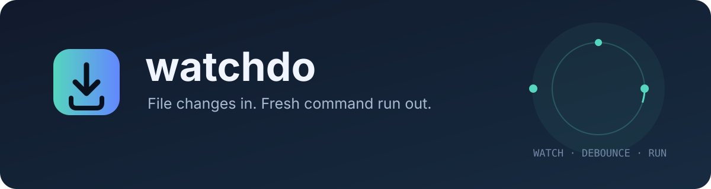

<p align="center">
  
</p>

<p align="center">
  
  
  
</p>

# watchdo

**A tiny, zero-dependency file watcher that reruns any command when your files change.** No daemon, no package installation, no third-party watcher library. Just Python's standard library.

## Quick start

```bash
python watchdo.py -- python app.py
```

Watch a specific directory and run a build command:

```bash
python watchdo.py --watch src --watch tests -- python -m unittest discover
```

If you install the script somewhere on your `PATH`, you can use `watchdo` instead of `python watchdo.py`.

## Usage

```text
watchdo [options] -- COMMAND [ARG ...]
```

| Option | Description | Default |
|---|---|---|
| `-w, --watch PATH` | File or directory to watch; repeat to add paths | `.` |
| `-i, --ignore GLOB` | Ignore a relative-path glob; repeatable | common cache folders |
| `-d, --debounce SECONDS` | Quiet period before the next run | `0.25` |
| `-p, --poll-interval SECONDS` | Filesystem polling interval | `0.5` |
| `--clear` | Clear the terminal before each run | off |
| `--once` | Run the command once and exit | off |
| `--version` | Print version | — |
| `-h, --help` | Show help | — |

### Examples

```bash
python watchdo.py -- python app.py
python watchdo.py -w src -w tests -i 'dist/**' -d 0.4 -- pytest
python watchdo.py --once -- python --version
```

## How it works

- Takes a snapshot of regular files and checks file size and modification time.
- Polls selected paths and waits for the debounce interval after changes settle.
- Starts your command immediately, then waits for changes after it exits.
- Sends a graceful termination signal to the previous process group before restarting it.
- Ignores common generated folders such as `.git`, `__pycache__`, `.venv`, and `.pytest_cache` by default.

Polling is portable and requires no native extensions. Very large trees or filesystems with unusual timestamp behavior may be better served by an OS-native watcher.

## Requirements

- Python 3.8 or newer
- No external Python packages
- Linux, macOS, or Windows

## Tests

```bash
python -m unittest discover -s tests -v
```

## License

MIT — see [LICENSE](LICENSE).
